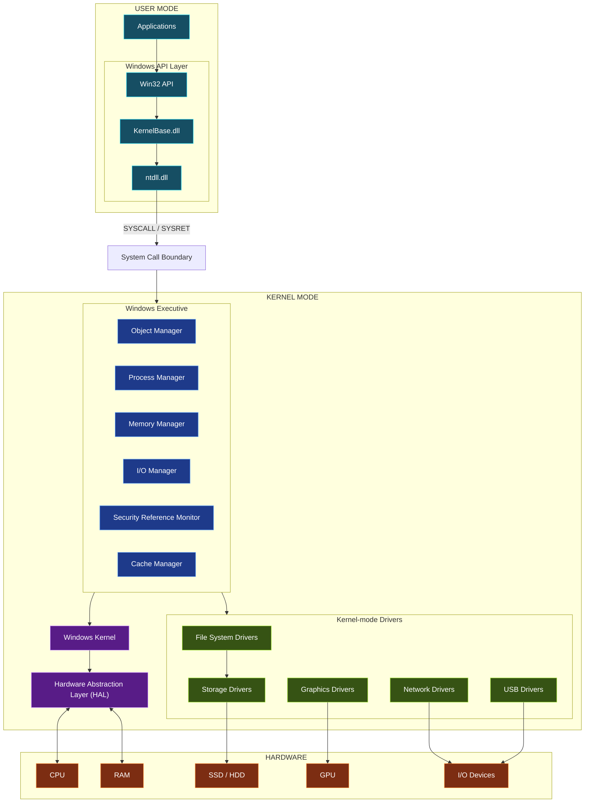
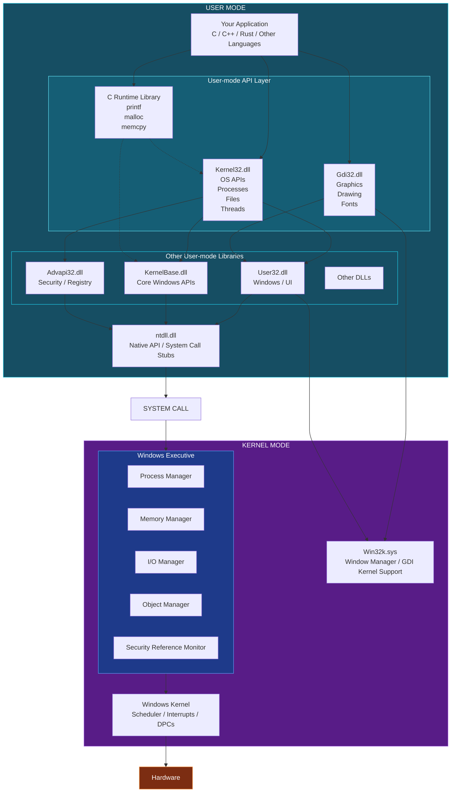

# 그림 출처

### 국내 유료 win32강의 인프런(Windows System 프로그래밍)
- Windows System 프로그래밍 | Windows용 게임과 어플리케이션을 개발하기 위한 필수 Windows System프로그래밍 기술을 알려드립니다.
  - https://www.inflearn.com/course/windows-system-programming?cid=336247


# 여기에 정리함
- https://younghakim7.github.io/blog/posts/study_windowsos_kernel_001/

### category
- https://younghakim7.github.io/blog/archive/category/rust_Kernel_WindowsOS/

Let's visualize the Windows OS architecture entirely in the terminal, using ASCII diagrams. You can save these diagrams as `.txt` files and view them in Helix, Vim, Neovim, or directly in your terminal.

The goal is to understand how Windows connects user applications, system calls, the kernel, kernel managers, device drivers, and hardware.

# 1. Overall Windows architecture

```
+----------------------------------------------------------+
|                     USER MODE                            |
|                                                          |
|  +----------------+  +----------------+  +-------------+ |
|  | Application A  |  | Application B  |  | Application C|
|  +-------+--------+  +-------+--------+  +------+------ + |
|          |                   |                  |        |
|  +-------v-------------------v------------------v------+ |
|  |                  Win32 API                           | |
|  |  KernelBase.dll | User32.dll | Gdi32.dll | Advapi32  | |
|  +--------------------------+---------------------------+ |
|                             |                            |
|  +--------------------------v---------------------------+ |
|  |                    ntdll.dll                          | |
|  |          Native API / System Call Stubs               | |
|  +--------------------------+---------------------------+ |
+=============================|============================+
                              |
                       SYSTEM CALL
                         SYSCALL
                              |
+=============================|============================+
|                     KERNEL MODE                          |
|  +--------------------------v---------------------------+ |
|  |                    ntoskrnl.exe                       | |
|  |                                                      | |
|  |  +-----------------------------------------------+   | |
|  |  |              Windows Executive                |   | |
|  |  |                                               |   | |
|  |  |  +----------------+  +---------------------+  |   | |
|  |  |  | Object Manager |  | Process Manager     |  |   | |
|  |  |  +----------------+  +---------------------+  |   | |
|  |  |                                               |   | |
|  |  |  +----------------+  +---------------------+  |   | |
|  |  |  | Memory Manager |  | I/O Manager         |  |   | |
|  |  |  +----------------+  +---------------------+  |   | |
|  |  |                                               |   | |
|  |  |  +----------------+  +---------------------+  |   | |
|  |  |  | Security       |  | Cache Manager       |  |   | |
|  |  |  +----------------+  +---------------------+  |   | |
|  |  +-----------------------------------------------+   | |
|  |                                                      | |
|  |  +-----------------------------------------------+   | |
|  |  |              Windows Kernel                   |   | |
|  |  |                                               |   | |
|  |  |  Scheduler | Interrupts | Synchronization     |   | |
|  |  |  Dispatcher | Exceptions | Timers             |   | |
|  |  +-----------------------------------------------+   | |
|  +------------------------------------------------------+ |
|                                                          |
|  +------------------------------------------------------+ |
|  |                  HAL (hal.dll)                       | |
|  +------------------------------------------------------+ |
|                                                          |
|  +------------------------------------------------------+ |
|  |                Kernel-mode Drivers                   | |
|  |                                                      | |
|  |  File System | Storage | Network | USB | GPU         | |
|  +----------------------------+-------------------------+ |
+===============================|==========================+
                                |
+===============================v==========================+
|                         HARDWARE                         |
|                                                          |
|  +----------+ +----------+ +----------+ +-------------+ |
|  | CPU      | | RAM      | | SSD      | | GPU         | |
|  +----------+ +----------+ +----------+ +-------------+ |
|                                                          |
|  +----------+ +----------+ +--------------------------+ |
|  | Keyboard | | Mouse    | | Network Controller       | |
|  +----------+ +----------+ +--------------------------+ |
+----------------------------------------------------------+
```

Important: This is a conceptual diagram, not a literal executable-module hierarchy. The Executive and Kernel are closely integrated within `ntoskrnl.exe`; HAL and drivers are separate kernel-mode components.

# 2. User mode vs. kernel mode

The most important boundary in Windows is the transition between user mode and kernel mode.

```
              USER MODE
     +--------------------------+
     |                          |
     |   Application            |
     |       |                  |
     |       v                  |
     |   Win32 API              |
     |       |                  |
     |       v                  |
     |   ntdll.dll              |
     |       |                  |
     +-------|------------------+
             |
             | SYSCALL
             |
=============|====================== PRIVILEGE BOUNDARY
             |
             v
              KERNEL MODE
     +--------------------------+
     |                          |
     |   System Service         |
     |       |                  |
     |       v                  |
     |   Executive              |
     |       |                  |
     |       v                  |
     |   Kernel                 |
     |       |                  |
     |       v                  |
     |   Hardware / Drivers     |
     |                          |
     +--------------------------+
```

On x86-64 Windows:

| Mode        | CPU privilege level |
| ----------- | ------------------- |
| User mode   | CPL 3               |
| Kernel mode | CPL 0               |

The `SYSCALL` instruction is one mechanism used to transition into kernel mode.

# 3. Windows Executive architecture

The Executive provides higher-level operating system services.

```
                 WINDOWS EXECUTIVE
+--------------------------------------------------+
|                                                  |
|  +--------------------+  +---------------------+ |
|  | Object Manager     |  | Process Manager     | |
|  |                    |  |                     | |
|  | Objects            |  | Processes           | |
|  | Handles            |  | Threads             | |
|  | Namespaces         |  | Jobs                | |
|  +--------------------+  +---------------------+ |
|                                                  |
|  +--------------------+  +---------------------+ |
|  | Memory Manager     |  | I/O Manager         | |
|  |                    |  |                     | |
|  | Virtual Memory     |  | IRPs                | |
|  | Physical Memory    |  | Device Objects      | |
|  | Page Faults        |  | Driver Dispatch     | |
|  +--------------------+  +---------------------+ |
|                                                  |
|  +--------------------+  +---------------------+ |
|  | Security Reference |  | Cache Manager       | |
|  | Monitor            |  |                     | |
|  |                    |  | File Cache          | |
|  | Access Control     |  | Memory Mapping      | |
|  +--------------------+  +---------------------+ |
|                                                  |
+--------------------------------------------------+
```

Study each manager separately.

| Manager                    | Main responsibility               |
| -------------------------- | --------------------------------- |
| Object Manager             | Objects, handles, namespaces      |
| Process Manager            | Processes and threads             |
| Memory Manager             | Virtual memory and physical pages |
| I/O Manager                | Communication with device drivers |
| Security Reference Monitor | Access checking                   |
| Cache Manager              | File-system caching               |

# 4. Windows process creation flow

Let's follow a real operation.

An application calls:

```
CreateProcessW(
    L"C:\\Windows\\System32\\notepad.exe",
    NULL,
    NULL,
    NULL,
    FALSE,
    0,
    NULL,
    NULL,
    &startup_info,
    &process_info
);
```

Conceptual execution flow:

```
+-----------------------------+
| Application                 |
+--------------+--------------+
               |
               v
+-----------------------------+
| CreateProcessW()            |
| KernelBase.dll              |
+--------------+--------------+
               |
               v
+-----------------------------+
| Native API / ntdll.dll      |
+--------------+--------------+
               |
               v
+-----------------------------+
| System Call                 |
+--------------+--------------+
               |
               v
+-----------------------------+
| Windows Kernel              |
+--------------+--------------+
               |
               v
+-----------------------------+
| Process Manager             |
|                             |
| - Create process            |
| - Create initial thread     |
| - Initialize process state  |
+--------------+--------------+
               |
               v
+-----------------------------+
| Memory Manager              |
|                             |
| - Address space             |
| - Virtual memory            |
| - Page tables               |
+--------------+--------------+
               |
               v
+-----------------------------+
| Object Manager              |
|                             |
| - Process object            |
| - Thread object             |
| - Handles                   |
+--------------+--------------+
               |
               v
+-----------------------------+
| New process execution       |
+-----------------------------+
```

This is a simplified conceptual flow: process creation involves several cooperating subsystems, and their exact execution order is more complicated.

# 5. Windows memory management

Since you have been studying x86-64 page tables and MMU implementation, this is especially important.

```
          VIRTUAL MEMORY
+--------------------------------+
| Process A Address Space         |
|                                |
|  0x0000000000400000             |
|  +--------------------------+  |
|  | Executable               |  |
|  +--------------------------+  |
|                                |
|  0x0000000010000000             |
|  +--------------------------+  |
|  | Heap                     |  |
|  +--------------------------+  |
|                                |
|  0x00007FFFFFFFF000             |
|  +--------------------------+  |
|  | Stack                    |  |
|  +--------------------------+  |
+----------------+---------------+
                 |
                 v
+--------------------------------+
| Windows Memory Manager         |
|                                |
| Virtual Address Management     |
| Page Fault Handling            |
| Working Set Management         |
| Physical Page Management       |
+----------------+---------------+
                 |
                 v
+--------------------------------+
| Hardware Page Tables           |
|                                |
| PML4                           |
|  |                             |
|  +--> PDPT                     |
|        |                       |
|        +--> PD                  |
|               |                |
|               +--> PT           |
+----------------+---------------+
                 |
                 v
+--------------------------------+
| Physical RAM                   |
+--------------------------------+
```

Remember: Windows Memory Manager manages memory policies and mappings, while the CPU's MMU performs hardware address translation.

# 6. Windows interrupt handling

```
             HARDWARE DEVICE
                    |
                    v
             Hardware Interrupt
                    |
                    v
          +--------------------+
          | Interrupt Dispatch |
          +---------+----------+
                    |
                    v
          +--------------------+
          | ISR                |
          | Interrupt Service  |
          | Routine            |
          +---------+----------+
                    |
                    v
          +--------------------+
          | DPC                |
          | Deferred Procedure |
          | Call               |
          +---------+----------+
                    |
                    v
          +--------------------+
          | Kernel Scheduler   |
          +---------+----------+
                    |
                    v
          +--------------------+
          | Thread Execution   |
          +--------------------+
```

Important concepts:

- IDT: Interrupt Descriptor Table.
- ISR: Interrupt Service Routine.
- IRQL: Interrupt Request Level.
- DPC: Deferred Procedure Call.
- APC: Asynchronous Procedure Call.

Note that this is a simplified path. Not every interrupt requires a DPC or causes a context switch.

# 7. Windows I/O architecture

For example, when an application reads a file:

```
+--------------------------+
| Application              |
|                          |
| ReadFile()               |
+------------+-------------+
             |
             v
+--------------------------+
| Windows API              |
+------------+-------------+
             |
             v
+--------------------------+
| I/O Manager               |
|                          |
| Creates IRP              |
+------------+-------------+
             |
             v
+--------------------------+
| File System Driver       |
|                          |
| NTFS                     |
+------------+-------------+
             |
             v
+--------------------------+
| Storage Driver           |
+------------+-------------+
             |
             v
+--------------------------+
| Disk Controller          |
+------------+-------------+
             |
             v
+--------------------------+
| SSD / HDD                |
+--------------------------+
```

The central concept here is `IRP` (I/O Request Packet).

# 8. Generate and view the architecture from your terminal

Here is a practical way to keep these diagrams in your Windows kernel study repository.

Suggested directory structure:

```
windows-kernel-study/
|
+-- README.md
|
+-- architecture/
|   |
|   +-- 01-overall.txt
|   +-- 02-user-kernel.txt
|   +-- 03-executive.txt
|   +-- 04-process.txt
|   +-- 05-memory.txt
|   +-- 06-interrupt.txt
|   +-- 07-io.txt
|
+-- exercises/
    |
    +-- process/
    +-- memory/
    +-- interrupts/
    +-- drivers/
    +-- debugging/
```

You can use `cat`, `less`, and `hx` (Helix).

```
# Display directly
cat architecture/01-overall.txt

# Scroll through the diagram
less architecture/01-overall.txt

# Open with Helix
hx architecture/01-overall.txt
```

You can also use Mermaid diagrams in Markdown and render them with a Mermaid CLI installation:

```
npm install -g @mermaid-js/mermaid-cli
```

Example `architecture/overall.mmd`:



Render it:

```
mmdc -i architecture/overall.mmd \
     -o architecture/overall.svg
```

# 9. What to study next

I recommend following this exact progression:

## Windows kernel learning sequence

1. Windows architecture

   Understand user mode, kernel mode, Executive, Kernel, HAL, and drivers.
2. System calls

   Follow `CreateFileW()` from Win32 to the kernel.
3. Process and thread management

   Investigate `EPROCESS`, `ETHREAD`, and `KTHREAD`.
4. Memory management

   Investigate virtual addresses, PML4, PTEs, and page faults.
5. Interrupts and scheduling

   Investigate ISR, DPC, APC, IRQL, and context switching.
6. I/O and drivers

   Investigate IRPs, device objects, and driver stacks.

My recommendation: Start with diagrams 1–3, then investigate each subsystem using WinDbg. Compare the Windows concepts against your own Rust x86-64 operating system implementation. This will help you understand not just what each Windows component does, but why an operating system needs it.





# `Gdi32.dll`**,&#x20;**`Kernel32.dll`**

The key difference is that `Gdi32.dll`**,&#x20;**`Kernel32.dll`**, and the C Runtime Library (CRT) provide different kinds of services to an application.**

They are all user-mode libraries, but they serve different purposes.

- `Gdi32.dll`: Graphics and drawing.
- `Kernel32.dll`: Core Windows operating-system services exposed to applications.
- C Runtime Library (CRT): Standard C language runtime functionality.

Let's examine their roles in the Windows architecture.

# **1. Where they fit in Windows architecture**

```
                  USER MODE
+-------------------------------------------+
|              Your Application             |
|                                           |
|  C / C++ / Rust / Other Languages         |
+---------------------+---------------------+
                      |
                      v
+-------------------------------------------+
|             User-mode API Layer           |
|                                           |
|  +-------------+ +----------+ +---------+ |
|  | Gdi32.dll   | |Kernel32  | | CRT     | |
|  |             | |.dll      | |         | |
|  | Graphics    | | OS APIs  | | C       | |
|  | Drawing     | | Processes| | Runtime | |
|  | Fonts       | | Files    | | Memory  | |
|  |             | | Threads  | | printf  | |
|  +------+------+ +----+-----+ +---------+ |
|         |             |                   |
|         v             v                   |
|  +-------------------------------------+  |
|  |       Other User-mode Libraries     |  |
|  |                                     |  |
|  | User32.dll | KernelBase.dll         |  |
|  | Advapi32.dll | Other DLLs           |  |
|  +------------------+------------------+  |
|                     |                     |
|                 ntdll.dll                 |
+=====================|=====================+
                      |
                  SYSTEM CALL
                      |
+=====================|=====================+
|                 KERNEL MODE               |
|                                           |
|  +-------------------------------------+  |
|  | Windows Executive                   |  |
|  |                                     |  |
|  | Process Manager                     |  |
|  | Memory Manager                      |  |
|  | I/O Manager                         |  |
|  | Object Manager                      |  |
|  +-------------------------------------+  |
|                                           |
|             Windows Kernel                |
+-------------------------------------------+
```

This is a conceptual view. These DLLs do not all call the kernel directly, and their internal call paths vary by API and Windows version.

# **2.&#x20;**`Kernel32.dll`**&#x20;— Windows operating-system APIs**

Windows API

`Kernel32.dll` provides applications with access to fundamental Windows operating-system services.

Despite its name, **Kernel32.dll does not contain the Windows kernel**. It is a user-mode DLL.

Its responsibilities include:

| Category        | Example APIs                | Purpose                          |
| --------------- | --------------------------- | -------------------------------- |
| Process         | `CreateProcessW()`          | Create processes                 |
| Thread          | `CreateThread()`            | Create threads                   |
| Memory          | `VirtualAlloc()`            | Allocate virtual memory          |
| File            | `CreateFileW()`             | Open or create files             |
| File I/O        | `ReadFile()`, `WriteFile()` | Read and write files             |
| Synchronization | `WaitForSingleObject()`     | Wait for synchronization objects |
| Time            | `GetSystemTime()`           | Retrieve system time             |
| Library loading | `LoadLibraryW()`            | Load DLLs                        |

Example:

```
#include <windows.h>
#include <stdio.h>

int main(void)
{
    HANDLE file = CreateFileW(
        L"example.txt",
        GENERIC_WRITE,
        0,
        NULL,
        CREATE_ALWAYS,
        FILE_ATTRIBUTE_NORMAL,
        NULL
    );

    if (file == INVALID_HANDLE_VALUE) {
        printf("CreateFileW failed: %lu\n", GetLastError());
        return 1;
    }

    const char *message = "Hello Windows!\n";
    DWORD written = 0;

    WriteFile(
        file,
        message,
        (DWORD)strlen(message),
        &written,
        NULL
    );

    CloseHandle(file);

    return 0;
}
```

Include `<string.h>` for `strlen()`.

Conceptual call chain:

```
Application
    |
    v
CreateFileW()
    |
    v
Kernel32.dll
    |
    v
KernelBase.dll
    |
    v
ntdll.dll
    |
    v
System Call
    |
    v
Windows Kernel
    |
    v
I/O Manager
    |
    v
File System Driver
```

Modern Windows versions implement many Kernel32 APIs through `KernelBase.dll`. The exact path depends on the API.

# **3.&#x20;**`Gdi32.dll`**&#x20;— Graphics Device Interface**

Graphics API

`Gdi32.dll` provides the Windows Graphics Device Interface (GDI).

Its primary responsibility is drawing graphical content.

Examples:

| API                     | Purpose              |
| ----------------------- | -------------------- |
| `TextOutW()`            | Draw text            |
| `LineTo()`              | Draw a line          |
| `Rectangle()`           | Draw a rectangle     |
| `Ellipse()`             | Draw an ellipse      |
| `BitBlt()`              | Copy pixel data      |
| `CreatePen()`           | Create a drawing pen |
| `CreateBrushIndirect()` | Create a brush       |

Example:

```
#include <windows.h>

void draw(HDC hdc)
{
    Rectangle(hdc, 50, 50, 250, 150);

    MoveToEx(hdc, 50, 200, NULL);
    LineTo(hdc, 250, 200);

    TextOutW(hdc, 50, 250, L"Hello GDI!", 10);
}
```

Conceptual call chain:

```
Application
    |
    v
Gdi32.dll
    |
    v
User-mode graphics subsystem
    |
    v
Win32 system interface
    |
    v
Win32k.sys
    |
    v
Kernel-mode graphics subsystem
    |
    v
Display Driver / Graphics Hardware
```

Note that modern Windows graphics involve additional components, such as DirectX, DXGI, and the Desktop Window Manager (DWM). GDI is not the entire Windows graphics architecture.

# **4. C Runtime Library (CRT)**

Language Runtime

The CRT is fundamentally different from the previous two libraries.

It provides functionality required by C programs, rather than being a Windows API library.

For example:

| Function   | Purpose                     |
| ---------- | --------------------------- |
| `printf()` | Formatted output            |
| `scanf()`  | Formatted input             |
| `malloc()` | Dynamic memory allocation   |
| `free()`   | Release allocated memory    |
| `memcpy()` | Copy memory                 |
| `strlen()` | Calculate string length     |
| `fopen()`  | Open a file using C streams |
| `fclose()` | Close a C stream            |
| `exit()`   | Terminate a C program       |

Example:

```
#include <stdio.h>
#include <stdlib.h>
#include <string.h>

int main(void)
{
    char *buffer = malloc(128);

    if (buffer == NULL)
        return 1;

    strcpy(buffer, "Hello CRT!");

    printf("%s\n", buffer);

    free(buffer);

    return 0;
}
```

The CRT handles operations such as:

```
printf()
   |
   v
CRT formatting
   |
   v
stdout stream
   |
   v
Windows output APIs
   |
   v
Console subsystem
```

Similarly:

```
malloc()
   |
   v
CRT memory allocator
   |
   v
Windows heap APIs
   |
   v
Virtual Memory Manager
```

The CRT may use Windows APIs internally, but it also implements substantial functionality entirely in user mode.

For Microsoft's compiler toolchain, important runtime libraries include:

- `UCRT` — Universal C Runtime.
- `VCRUNTIME` — Visual C++ runtime support.
- `MSVCRT` — Microsoft C runtime library, also relevant to compatibility with older applications.

# **5. Compare the three libraries**

| Feature          | Gdi32.dll   | Kernel32.dll                    | CRT                                                |
| ---------------- | ----------- | ------------------------------- | -------------------------------------------------- |
| Type             | Windows API | Windows API                     | Language runtime                                   |
| Main purpose     | Graphics    | OS services                     | C language support                                 |
| `printf()`       | No          | No                              | Yes                                                |
| `malloc()`       | No          | Provides related OS memory APIs | Yes                                                |
| `CreateFileW()`  | No          | Yes                             | No                                                 |
| `TextOutW()`     | Yes         | No                              | No                                                 |
| `CreateThread()` | No          | Yes                             | No                                                 |
| Windows-specific | Yes         | Yes                             | No, although implementations are platform-specific |

# **6. How they work together**

Consider a C application that allocates memory, writes a file, and draws text.

```
                  APPLICATION
                       |
          +------------+------------+
          |            |            |
          v            v            v
       printf()    malloc()    TextOutW()
          |            |            |
          v            v            v
         CRT        CRT         Gdi32.dll
          |            |            |
          |            v            |
          |        Kernel32.dll     |
          |            |            |
          |            v            |
          |       KernelBase.dll    |
          |                         |
          v                         v
     Console / File             Graphics
          |                         |
          +------------+------------+
                       |
                       v
                 Windows OS
```

This diagram is simplified: the CRT may call Windows APIs directly, and the precise paths depend on the runtime and API.

# **7. How to inspect these DLLs yourself**

Since you're studying Windows internals, I recommend inspecting the actual DLLs rather than only reading documentation.

Open a Visual Studio Developer Command Prompt or a terminal with LLVM tools installed.

```
# Locate Windows DLLs
where.exe kernel32.dll

# Inspect exported symbols with LLVM
llvm-readobj --coff-exports C:\Windows\System32\kernel32.dll

llvm-readobj --coff-exports C:\Windows\System32\gdi32.dll

# Inspect a C runtime DLL (if installed)
llvm-readobj --coff-exports C:\Windows\System32\ucrtbase.dll
```

You can also use:

```
dumpbin /exports C:\Windows\System32\kernel32.dll
dumpbin /exports C:\Windows\System32\gdi32.dll
```

Notice that DLL exports and actual implementation locations are not necessarily the same thing. Some exported functions are forwarded to other DLLs.

## **8. The most important conceptual distinction**

Think about these three libraries like this:

```
+----------------------------------+
|          C Runtime (CRT)         |
|                                  |
|  How does C provide functionality?|
|                                  |
|  printf, malloc, memcpy, strlen  |
+----------------------------------+

+----------------------------------+
|          Kernel32.dll            |
|                                  |
|  How does an application use     |
|  Windows operating-system APIs?  |
|                                  |
|  CreateProcess, CreateFile,      |
|  VirtualAlloc, CreateThread     |
+----------------------------------+

+----------------------------------+
|           Gdi32.dll              |
|                                  |
|  How does an application draw    |
|  graphics using Windows GDI?     |
|                                  |
|  TextOut, Rectangle, BitBlt      |
+----------------------------------+
```

- **My recommendation for your Windows kernel studies:** Investigate the difference between Win32 API, Native API (`ntdll.dll`), and system calls next. Understanding those three layers will help you understand how user-mode applications communicate with the actual Windows kernel.

- 🖥️Practice Windows API and kernel call paths weeklyTap to set up
